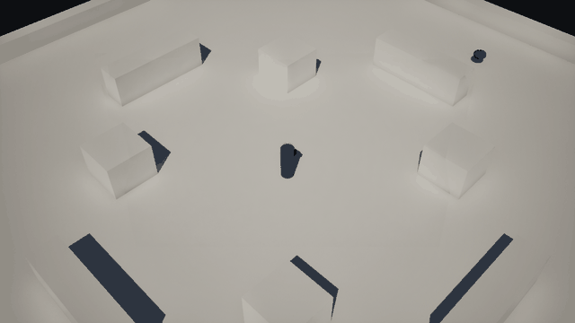
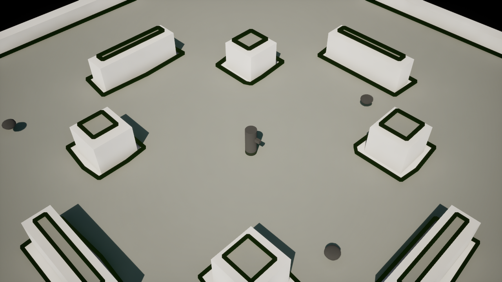
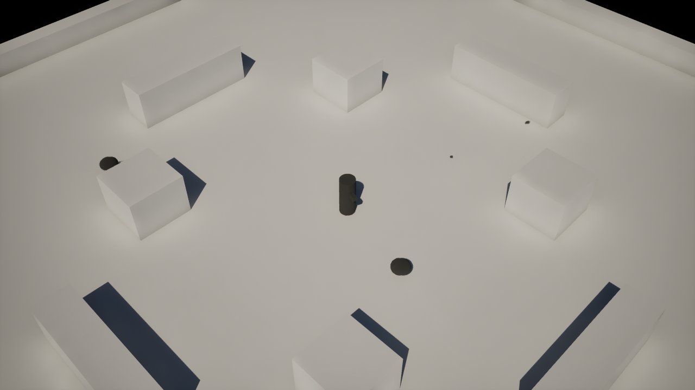
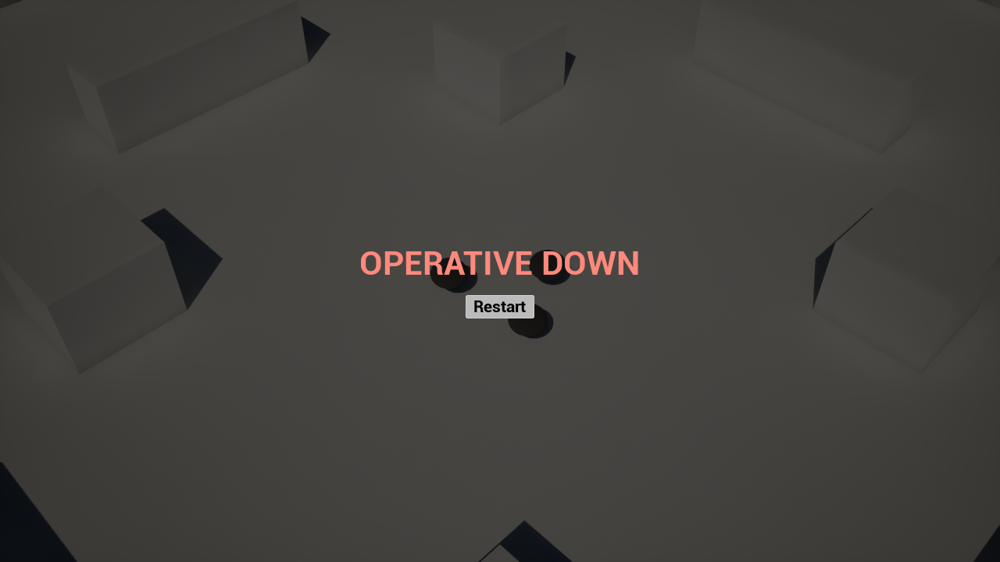

# Protocol Zero

A single-player, top-down sci-fi arena survival shooter built in **Unreal Engine 5.8 with C++**.

A lone security operative is trapped in a research facility after its experimental AI defense system turns hostile. Survive five escalating waves of drones, take an upgrade after each wave, and clear Wave 5 to trigger Protocol Zero and shut the system down. A run lasts about 8 to 12 minutes.

> **Status: in development.** Milestone 1, the core combat slice, is playable: movement, cursor aiming, automatic fire, Hunter drones, death and restart. Waves, the Sentry drone, upgrades and the HUD are next. The art is greybox placeholder until the final models arrive.



| Arena and cover | Combat | Defeat |
|---|---|---|
|  |  |  |

## Gameplay

- **Fixed 45° isometric camera**, with WASD movement relative to the camera. Diagonals are not faster.
- **Continuous cursor aim.** The operative always faces the mouse.
- **Plasma rifle.** Hold the left mouse button for automatic fire. Bolts are visible and take time to travel. They hit drones and cover, never the player or other projectiles.
- **Hunter drone.** It follows the navmesh around cover to reach the player, then attacks in melee on a cooldown. There is no contact damage.
- **Health with a post-hit grace window**, so stacked hits cannot kill instantly. Destroyed drones play a short destruction effect, then despawn.
- **Death and restart.** A death effect plays, then a defeat prompt lets you restart the run from the same baseline.

## Engineering highlights

- **C++ first, data-driven tuning.** Gameplay rules live in C++. Every tunable number (weapon damage and cooldown, drone health, speed and attack values) lives in Unreal Data Assets, so balance changes need no code.
- **Engine-free rule cores.** Health, fire cadence, melee cooldown, aim math, movement math and the destruction curve are plain C++ structs and functions. Time is passed in, which makes them deterministic and unit-testable without a game world.
- **Frame-rate-independent automatic fire.** The fire cadence counts every shot due since the last frame, so long frames never drop shots and re-pressing the trigger never beats the cooldown.
- **Custom collision channels.** `PlayerProjectile`, `EnemyProjectile` and `Enemy` object channels encode who can hit whom: no friendly fire, no projectile-versus-projectile hits, and cover blocks everything.
- **Navmesh AI.** An `AAIController` subclass drives pursuit and melee on a 10 Hz decision tick, while path following runs on its own.
- **UMG built in C++.** The defeat prompt constructs its widget tree in code, with localizable text and no Widget Blueprint dependency.

## Tests

33 Unreal automation tests cover health and the grace window, movement, aiming, fire cadence, melee, the destruction curve, and projectile collision. The projectile tests spawn real bolts in a test world and verify they damage enemies, stop at cover and pass through the player.

```bash
UnrealEditor-Cmd.exe "<abs path>/Protocol_Zero.uproject" -ExecCmds="Automation RunTests Protocol_Zero.; Quit" -unattended -nullrhi -stdout
```

## Architecture

| Area | Key classes |
|---|---|
| Run flow | `APZGameMode` |
| Player | `APZPlayerCharacter`, `APZPlayerController`, `PZMovementMath`, `PZAimMath` |
| Combat | `UPZHealthComponent` / `FPZHealthState`, `UPZWeaponComponent` / `FPZFireCadence`, `APZProjectile`, `FPZMeleeAttack`, `UPZWeaponData` |
| Enemies | `APZDrone`, `APZHunterAIController`, `UPZDroneData`, `PZDestructionMath` |
| Arena | `APZSpawnPoint`, `L_Arena_Greybox` (baked navmesh) |
| UI | `UPZDefeatWidget` |

Source lives in `Source/Protocol_Zero/`, split into `Public/` and `Private/`. Tests are in `Private/Tests/`. Editor Python scripts that rebuild the arena and data assets are in `tools/editor/`.

## Roadmap

1. **Core combat slice:** done.
2. **Full wave loop:** five escalating waves of timed spawn groups, the ranged Sentry drone, pause, and victory and defeat results screens.
3. **Upgrades and HUD:** three random picks after each wave from damage, fire rate, projectile count and max health, plus a HUD with health, wave, enemies remaining and upgrades, and damage feedback.
4. **Presentation:** intro text and the Protocol Zero shutdown sequence, SFX and music, settings, an art pass and final tuning.

The full design is in [Protocol_Zero_Design.md](Protocol_Zero_Design.md), and the implementation plan is in [Protocol_Zero_Plan.md](Protocol_Zero_Plan.md).

## Building

1. Install **Unreal Engine 5.8** and Visual Studio 2022 with the C++ game development workload.
2. Clone with Git LFS installed, so the maps and assets download.
3. Right-click `Protocol_Zero.uproject`, choose **Generate Visual Studio project files**, then open the project. It builds the module on first launch.
4. Press **Play**. Use WASD to move, the mouse to aim, and hold the left mouse button to fire.
